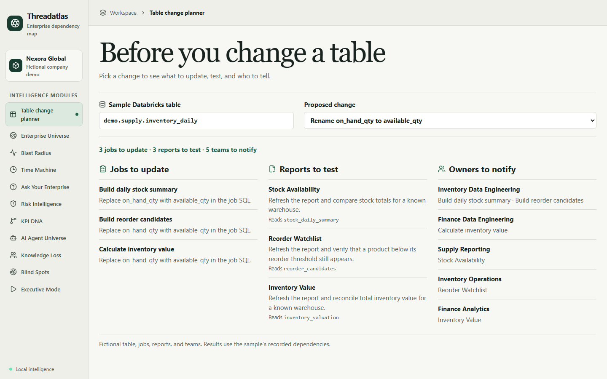

# Threadatlas

See what could break before you change a data table.

Threadatlas turns recorded dependencies into a change checklist: which jobs to update, which reports to test, and which teams to notify.



## Try the demo

1. Open Threadatlas to the **Table Change Planner**.
2. Select **Drop reorder_point** on the fictional inventory table.
3. Update the **Build reorder candidates** job, test the **Reorder Watchlist**, and notify the two teams shown. Select a different change to see how the checklist changes.

The planner uses built-in fictional data. The demo covers application outages and KPI lineage through the **Blast Radius** and **KPI DNA** screens. Run the app locally to try it.

## Run locally

Install Python 3.11, Node.js 24 and pnpm 11.25.0. With standard Node installations, install pnpm using `npm install -g pnpm@11.25.0`.

From the project directory, run these PowerShell commands in terminal one.

```powershell
python -m venv .venv
.\.venv\Scripts\python -m pip install -r backend/requirements-dev.txt
.\.venv\Scripts\python -m uvicorn backend.main:app --host 127.0.0.1 --port 8000
```

In terminal two, run the frontend.

```powershell
pnpm --dir frontend install --frozen-lockfile
pnpm --dir frontend dev --hostname 127.0.0.1
```

Use the Local URL printed by Next.js if port 3000 is already occupied. The frontend uses a hoisted pnpm layout for Windows drives that cannot create symlinks. First install can take several minutes on an external drive. Open [Threadatlas](http://127.0.0.1:3000) and [interactive API documentation](http://127.0.0.1:8000/docs). On macOS or Linux, the virtual-environment interpreter is `.venv/bin/python`. With Docker Compose, run `docker compose up --build` and open the same frontend URL. The SQLite scenario database is saved in a Docker volume or under `data/` in local development.

## How the graph works

- Edges point from dependent to prerequisite, asset to owner, or member to department. Each edge carries a typed relationship.
- Blast Radius follows reverse dependency edges by shortest hop. An affected entity is reachable from the failed entity. The model assumes no alternate dependency failover and does not estimate timing, outage probability or financial loss.
- KPI DNA follows dependencies toward source systems and includes recorded ownership edges. Definitions and transformations are synthetic metadata. KPI values are not computed from transaction records.
- Risk Intelligence reports missing owners, concentrated dependencies with at least eight transitive dependents, and processes with one prerequisite and no linked contingency plan. Contingency plans are illustrative procedures.
- The role removal simulation uses documented direct owners. Agent access findings apply a synthetic same-department baseline and indicate grants for review.
- The deterministic query interpreter recognizes named entities and supports impact, ownership and upstream lineage. Responses use the selected graph snapshot and require no external service.
- The graph browser pages results and excludes individual employees in the default view. Search or select the employee type to inspect individual employees.

## Optional local model

Run Ollama on the same machine as the Python API. Set `ENTERPRISEBRAIN_OLLAMA_MODEL` to an already installed local model before starting Uvicorn. The API sends a short synthetic evidence sample to the Ollama loopback address and presents the response as a model summary. The graph-derived answer and evidence remain available if the model is disabled, fails, or times out. [Ollama generate API](https://docs.ollama.com/api/generate)

## Run checks

```powershell
.\.venv\Scripts\python -m pytest -q
pnpm --dir frontend lint
pnpm --dir frontend build
pnpm --dir frontend exec playwright install chromium
pnpm --dir frontend test:e2e
```

Keep the API running for browser tests. Dependency audits run in CI. The repository is MIT licensed. Direct dependency licenses include MIT, BSD-3-Clause, ISC and Apache-2.0. See [project status](PROJECT_STATUS.md) for verification scope and remaining work.
